<!-- Generated by tools/main.py (step: docs). Do not edit by hand; edit tools/docs_text.py or ontology/qskos.ttl. -->

# QSKOS RDF export

The *LOD Export* tab of the QSKOS plugin writes annotated features as RDF (Turtle). The model combines four standards:

- **DCAT 3** for the metadata of an export (`qskos:Catalog`, `qskos:Dataset`, `qskos:Distribution`),
- **GeoSPARQL** for features, geometries and layers, readable by SPARQLing Unicorn,
- **Web Annotation** for the annotations (`oa:hasTarget`, `oa:hasBody`, `oa:motivatedBy oa:classifying`),
- **CIDOC CRM** (with CRMgeo) as the semantic superstructure of every class.

The exported data uses only `qskos:` classes. The crosswalk to the four standards is stated once, in the application ontology (`ontology/qskos.ttl`: 11 classes, 5 properties) as `rdfs:subClassOf`.



Sources: [model-simple.mmd](https://github.com/leiza-rse/QSKOS/blob/master/docs/diagrams/model-simple.mmd) · [SVG](https://github.com/leiza-rse/QSKOS/blob/master/docs/diagrams/model-simple.svg) · [PNG](https://github.com/leiza-rse/QSKOS/blob/master/docs/diagrams/model-simple.png)

## Pages

| Page | Content |
|---|---|
| [Model](model.html) | The three diagrams: data view, CIDOC CRM view, class hierarchy |
| [Vocabulary](vocabulary.html) | Every class and property: definition, superclasses, what the plugin writes |
| [Crosswalk](crosswalk.html) | QSKOS to DCAT and to CIDOC CRM (and GeoSPARQL, Web Annotation, SKOS) |
| [Report](report.html) | Counts for the ontology and the example export |

## Files

| File | Purpose |
|---|---|
| [`ontology/qskos.ttl`](https://github.com/leiza-rse/QSKOS/blob/master/ontology/qskos.ttl) | Application ontology with the crosswalk |
| [`ontology/shapes.ttl`](https://github.com/leiza-rse/QSKOS/blob/master/ontology/shapes.ttl) | SHACL shapes for validating an export |
| [`ontology/queries.rq`](https://github.com/leiza-rse/QSKOS/blob/master/ontology/queries.rq) | Unicorn query, CRM bridge rules (CONSTRUCT), DCAT view, consistency check |
| [`ontology/example.ttl`](https://github.com/leiza-rse/QSKOS/blob/master/ontology/example.ttl) | A synthetic export (generated) |

## Rebuild

```
python tools/main.py
```

Writes the example, the diagrams (SVG, PNG), this documentation and the report. See `python tools/main.py --list`.
