<!-- Generated by tools/main.py (step: docs). Do not edit by hand; edit tools/docs_text.py or ontology/qskos.ttl. -->

# Model

## Data view

What an export contains. Yellow: DCAT metadata layer; brown: QSKOS classes; green: the physical object; violet: vocabulary concepts.

Sources: [model-simple.mmd](https://github.com/leiza-rse/QSKOS/blob/master/docs/diagrams/model-simple.mmd) · [SVG](https://github.com/leiza-rse/QSKOS/blob/master/docs/diagrams/model-simple.svg) · [PNG](https://github.com/leiza-rse/QSKOS/blob/master/docs/diagrams/model-simple.png)

One `qskos:Annotation` is written per feature and annotation field. A cell with several selected concepts gives one annotation with several `oa:hasBody` values. The field concept is stored per annotation (`qskos:attribute`), because `skos:broaderTransitive` cannot tell in which field a value was recorded.

## CIDOC CRM view

The same model with the CRM class of every node. Dotted edges have no CRM property.

Sources: [model-cidoc.mmd](https://github.com/leiza-rse/QSKOS/blob/master/docs/diagrams/model-cidoc.mmd) · [SVG](https://github.com/leiza-rse/QSKOS/blob/master/docs/diagrams/model-cidoc.svg) · [PNG](https://github.com/leiza-rse/QSKOS/blob/master/docs/diagrams/model-cidoc.png)

## Class hierarchy

Generated from `ontology/qskos.ttl`: each QSKOS class with its direct superclasses.

Sources: [hierarchy.mmd](https://github.com/leiza-rse/QSKOS/blob/master/docs/diagrams/hierarchy.mmd) · [SVG](https://github.com/leiza-rse/QSKOS/blob/master/docs/diagrams/hierarchy.svg) · [PNG](https://github.com/leiza-rse/QSKOS/blob/master/docs/diagrams/hierarchy.png)

